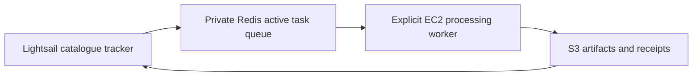

# Catalogue tracker

The dedicated Lightsail host runs `maritime_tip_cue.catalogue`, `maritime_tip_cue.job_manager` and Redis. The
GPU worker host runs `maritime_tip_cue.worker`. Each role has its own dependency list, but both require this
repository's shared `maritime_tip_cue` package source; they are not standalone sparse checkouts yet. The
scheduled catalogue and manager services do not start or stop EC2; the manual one-scene runner below uses the
configured wake status handler and keeps it active while the worker command runs.



## Lightsail installation

The tracker scan and always-on manager run from the same role-specific container image under systemd; Redis
remains the existing Ubuntu systemd service. Build from the repository root with
`sudo docker build -f deploy/catalogue/Dockerfile -t maritime-sts-manager .`. The image contains the deployment
`config.yaml`; both units mount only the persistent host `data/` directory and use `STS_CONFIG_PATH=/app/config.yaml`.
Copy this checkout to `/home/ubuntu/maritime-sts-monitor` and create the ignored `.env` there. It holds the AWS
credentials used for S3, `S3_BUCKET_NAME` and `STS_REDIS_URL`; keep it outside Git. Rebuild the image when code,
rules or deployment config changes. Follow the [Redis host deployment](redis/README.md) before enabling queue writes.

The ledger is the `processing` schema of the control-host Postgres database; every container reads
`STS_DATABASE_URL` from the same `.env` through `--env-file` (on the host it points at `127.0.0.1`; setup in
[../postgres/README.md](../postgres/README.md)). The bundled config keeps only the scan log under `/app/data`, which
maps to the host's persistent `data/` directory. Queue lease, heartbeat and retry settings are in that same config.

Establish the baseline by running `sudo docker run --rm --network host --user 1000:1000 --env-file .env -e STS_CONFIG_PATH=/app/config.yaml -v "$PWD/data:/app/data" maritime-sts-manager -m maritime_tip_cue.catalogue scan`.
Verify every site/sensor succeeded, then enable the systemd timer and manager service. Existing scenes are not
queued; `--backfill` is available only as an explicit alternative for an uninitialized channel. Do not delete
the ledger tables: they hold the baseline, discovery history and completed job history. A scan, the manager and
the one-scene runner share one session-level Postgres advisory lock, so only one of them touches the ledger at a time.

Install `sts-catalogue.service`, `sts-catalogue.timer` and `sts-job-manager.service` from this directory into
`/etc/systemd/system/`, run `systemctl daemon-reload`, then enable both the timer and manager service. The units
invoke Docker as root because the `ubuntu` account has no Docker socket access; each application container runs
as UID 1000 to preserve ownership of the persistent `data/` files. They use host networking to reach the Redis service
on localhost. The timer checks four times daily in UTC. The manager service runs in the foreground and restarts
on failure or host reboot. The manager does not start or stop EC2.

## One-scene end-to-end run

This command scans configured hot spots for new Sentinel-2 scenes, stops after the first eligible scene,
stores one single-scene job in the ledger, dispatches it to Redis, polls the configured wake status handler until
EC2 and private SSH are ready, then runs that exact job over SSH while polling the handler to refresh its idle
timer. If no new scene is found, it leaves EC2 untouched.

Set these deployment values in the Ubuntu host's ignored `.env`:

```text
WORKER_PRIVATE_IP=<WORKER_PRIVATE_IP>
WORKER_KEY_PATH=/home/ubuntu/.ssh/geogen-key.pem
WORKER_REMOTE_DIR=/home/ubuntu/maritime-sts-monitor-worker-test
WORKER_IMAGE=maritime-sts-gpu-worker:test
WORKER_WAKE_STATUS_URL=<WAKE_STATUS_URL>
```

The status URL must target the wake service's `/_wake/status` route. Each request refreshes its idle timer; the
runner polls it while the worker command is active. The Lightsail environment must also provide the existing
manager settings. The EC2 host must have the worker image, assets and instance role prepared. The worker role
must include the results-prefix `s3:ListBucket` permission documented in the worker deployment guide. The
runner checks this permission before the worker claims its Redis task.
After syncing this checkout and rebuilding the manager image, run on Ubuntu:

```bash
cd /home/ubuntu/maritime-sts-monitor
sudo docker build -f deploy/catalogue/Dockerfile -t maritime-sts-manager .
sudo python3 deploy/catalogue/run-one-scene.py
```

The script waits for the manager to record the result and prints the final job status. It leaves instance
shutdown to the wake service's idle policy.

To hand off one already discovered single-scene job, pass its job ID instead of scanning for a new scene:

```bash
sudo python3 deploy/catalogue/run-one-scene.py --job-id <job_id>
```

The job manager rejects unknown, multi-scene, claimed, completed or not-yet-retryable jobs before the wake
status handler is polled.

## Automatic worker dispatch

`sts-worker-dispatcher.timer` runs `dispatch_worker.py` every ten minutes on the Ubuntu host. It reads
`queue-status` from the job manager and does nothing, without touching the wake handler, unless at least one
job is ready (delayed retries do not count). When jobs are ready it holds `data/dispatcher/dispatcher.lock`,
wakes EC2 through the existing handler, and runs `worker drain` over SSH in a named container with a remote
`timeout`, removing the container afterwards. It stops polling the handler when the drain ends, so the wake
service's idle policy stops the instance.

Safeguards, all in `data/dispatcher/state.json` or environment settings:

- `DISPATCH_MAX_SESSION_SECONDS` (default 14400) bounds one session; the SSH client, the remote container and
  the local wake script are all terminated at the limit.
- `DISPATCH_MAX_NO_PROGRESS_SESSIONS` (default 3): that many consecutive sessions that complete no job open a
  breaker and the instance is no longer woken; inspect the failures, then `dispatch_worker.py --reset`.
- `DISPATCH_MAX_SECONDS_PER_DAY` (default 43200) caps worker time over a rolling 24 hours.
- `--pause` and `--resume` create or remove `data/dispatcher/paused`; pause it while processing locally.
- `--dry-run` prints the decision and queue counts and never wakes the instance.
- Inside the container the worker aborts on a lost lease, on Redis being unreachable for longer than the lease,
  and past `worker.queue.max_seconds_per_scene` times the job's scene count (set only in the worker config).

`job_manager queue-status` prints the Redis counts the dispatcher uses. `catalogue requeue-failed [--job-id ...]`
returns terminal failed jobs to pending with a fresh retry budget after their cause is fixed.

Install: copy both units to `/etc/systemd/system/`, `systemctl daemon-reload`,
`systemctl enable --now sts-worker-dispatcher.timer`. Rebuild the worker image on EC2 first.

### Pre-deployment test plan

Run in order on the Ubuntu host with `sudo python3 deploy/catalogue/dispatch_worker.py <flag>`; stop at the first
failure. None of steps 1-3 wakes EC2.

1. CI and local unit tests pass (`tests/test_dispatcher.py`, `tests/test_task_queue.py`, `tests/test_requeue_and_guards.py`).
2. `--preflight`: settings load, key permissions are 600, Docker and the manager image answer `queue-status`, the state
   directory is writable. Expect one JSON line with the queue counts and `breaker` 0.
3. `--dry-run`: expect `would-run` while jobs are ready and nothing is claimed, `skip` with the reason otherwise.
   Check `--pause` gives `paused` and `--resume` clears it. Also `catalogue audit` must show no violations or drift.
4. EC2 prerequisites, checked by hand: worker image rebuilt from this commit (the run.py fix and abort guards);
   `config.local.yaml` on EC2 has `worker.queue.max_seconds_per_scene`, since `worker drain` refuses without it;
   `nvidia-smi`, `/opt/ai2-models`, 3 GB free disk, instance profile S3 access.
5. Kill drill (wakes EC2): with one real ready job, run with `DISPATCH_MAX_SESSION_SECONDS=120`. Expect exit 124, no
   `sts-worker-drain` container left on EC2 (`docker ps`), the attempt recorded as `stopped` in `catalogue job-status`,
   the job back to `retry_wait`, and EC2 stopping by the wake service's idle policy. This spends one retry.
6. Live drain with defaults over one S2 and one S1 job from different hot spots: both `succeeded`, five artifacts
   under each attempt prefix and the attempt's run rows in Postgres, `progress` equal to the jobs finished, and
   `catalogue audit` clean afterwards. Repeat until every hot spot and both sensors have succeeded once.
7. Only then `systemctl enable --now sts-worker-dispatcher.timer`, and pause the dispatcher whenever the local
   runner is processing (it also skips while any job is claimed).

GPU guard settings in the host `.env`: `WORKER_GPU_FREE_CONTAINER` (name of the container to restart when it is idle and holds
the GPU; empty disables the guard), `WORKER_GPU_MIN_FREE_MIB` (default 5376), `WORKER_GPU_IDLE_MINUTES` (default 15). Design and
limits: `maritime_tip_cue/context/catalogue.md` `## Worker dispatcher`.

## Queue operation

The manager records every attempt in the Postgres ledger. Workers heartbeat every configured interval while holding a
lease; expired leases generate manager events. Result writes are fenced by the current owner and attempt ID,
and each attempt writes under its own S3 artifact prefix. A failed or timed-out attempt receives one delayed
retry. A second unsuccessful attempt becomes terminal in the ledger and Redis. Queue recovery rebuilds pending,
retry-waiting and terminal Redis state from the ledger without re-enqueueing jobs already running.

To scan and hand off only the first new single-scene job to Redis without starting EC2, run on Ubuntu:

```bash
cd /home/ubuntu/maritime-sts-monitor
sudo docker run --rm --network host --user 1000:1000 --env-file .env \
  -e STS_CONFIG_PATH=/app/config.yaml -v "$PWD/data:/app/data" \
  maritime-sts-manager -m maritime_tip_cue.job_manager scan-one
```

The result includes the selected `job_id`. The scan rotates its starting hot spot between runs, stops after
finding one eligible new scene, and creates no job when no new scene is found. First-time channel scans
establish the baseline and do not queue historical scenes.

To list or dispatch one already discovered single-scene job instead, use `catalogue jobs --single-scene` and:

```bash
sudo docker run --rm --network host --user 1000:1000 --env-file .env \
  -e STS_CONFIG_PATH=/app/config.yaml -v "$PWD/data:/app/data" \
  maritime-sts-manager -m maritime_tip_cue.job_manager once --job-id <job_id>
```

The targeted dispatch rejects manifests containing more than one scene. On EC2, use the documented worker
`run --job-id <job_id>` command to claim that exact job; the worker does not drain the rest of Redis. The
regular manager service continues its normal queue reconciliation.

The GPU worker's container build and run guide is in [the worker deployment guide](../gpu-worker/README.md).
Redis must be reachable on the Ubuntu private address from the GPU host; allow TCP 6379 only from the worker
private address or narrowest shared private subnet.

The worker uploads all-hull detection and raw-detection Parquets, run state, manifest and rules under
`catalogue/artifacts/<job_id>/<attempt>/`. For Redis-queued work, its result receipt is stored at the Redis
result key and announced on the result stream; the job manager verifies successful artifact metadata and
records success or failure in the ledger. Direct manifest runs retain the S3 result receipt path at
`catalogue/results/<job_id>.json`. Existing reviewed `sts/`
products are not overwritten.

Hotspot-test jobs use the separately tracked `hotspot-tests/areas.json` scan plan. The initial catalogue scan of a
new test area queues scenes from the area's `lookback_days` (10 days) window; later scans queue newly discovered scenes. The worker stores
their attempt artifacts and review images under `hotspot-tests/artifacts/` and `hotspot-tests/reviews/`, skips AIS,
and writes pair-only GeoParquets under `hotspot-tests/findings/<date>/<area>/<source>/`. These jobs never publish
to `sts/` or `sanctioned/`. The manager identity must be able to read test attempt artifacts and findings for receipt
validation. The exact control-host IAM additions are in the [app deployment guide](../app/README.md#hotspot-test-s3-iam).

See [component rationale](../../maritime_tip_cue/context/catalogue.md) for discovery, task grouping, retries
and publication boundaries.

## Random grid scan

`sts-grid-scan.timer` runs `python -m maritime_tip_cue.grid_scan plan` hourly at minute 20 UTC in the manager image. It resolves finished scans, closes or extends tiles and queues up to 25 first scenes and 50 scenes a day in total; the dispatcher and worker then process the jobs like any other. Install after rebuilding the manager image:

```bash
sudo docker build -f deploy/catalogue/Dockerfile -t maritime-sts-manager .
sudo docker run --rm --network host --user 1000:1000 --env-file .env -e STS_CONFIG_PATH=/app/config.yaml maritime-sts-manager -m maritime_tip_cue.pg init
sudo cp deploy/catalogue/sts-grid-scan.service deploy/catalogue/sts-grid-scan.timer /etc/systemd/system/
sudo systemctl daemon-reload && sudo systemctl enable --now sts-grid-scan.timer
```

`plan --dry-run` prints the tiles and scenes it would queue without writing. `status` prints the round, tile counts by status and today's budget; `export` prints every tile with its status for a map. Pause with `sudo systemctl stop sts-grid-scan.timer`; queued scenes still run.
