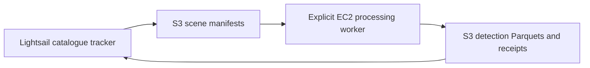

# Catalogue tracker

The dedicated Lightsail host runs `maritime_tip_cue.catalogue`. EC2 runs `maritime_tip_cue.worker` when
explicitly invoked. This deployment does not start or stop EC2.



## Lightsail installation

Deploy this repository to `/home/ubuntu/maritime-sts-monitor`, create its `.venv` with Python 3.12 and install
`deploy/catalogue/requirements.txt`. Store `AWS_ACCESS_KEY_ID`, `AWS_SECRET_ACCESS_KEY`, `AWS_REGION` and
`S3_BUCKET_NAME` in a protected, ignored `.env`. The tracker needs the shared hot-spot object and read/write
access to its configured catalogue prefixes. Conditional writes are required; completed receipt verification
also needs object metadata access.

Run `python -m maritime_tip_cue.catalogue scan` once to establish the baseline. Verify every site/sensor
succeeded before enabling the timer. Existing scenes are not queued; `--backfill` is available only as an
explicit alternative for an uninitialized channel. Do not delete the tracker database to repair a service
failure: it holds the baseline and dispatch outbox.

Install `sts-catalogue.service` and `sts-catalogue.timer` from this directory into `/etc/systemd/system/`, run
`systemctl daemon-reload`, then `systemctl enable --now sts-catalogue.timer`. The timer checks four times daily
in UTC. `Persistent=true` catches a missed scheduled activation after downtime.

## Inspecting discoveries

```text
python -m maritime_tip_cue.catalogue status
python -m maritime_tip_cue.catalogue scan
journalctl -u sts-catalogue.service
```

`data/catalogue/scans.jsonl` records scan times, eligible scene IDs, new IDs, baseline status, failures and
queue counts for every site and source. `data/catalogue/tracker.db` holds the durable observations, jobs and
receipts. A failed source is logged separately; it does not prevent other sites from being checked.

## EC2 handoff

Each pending job becomes `catalogue/jobs/<job_id>.json` in S3. Its site boundary, STAC scene items and rules
are frozen. The EC2 installation needs this repo's normal processing dependencies, Ai2 detector installation,
models, coastline/structure assets, S3 credentials, AIS credentials and pinned certificate. Set deployment
paths in an ignored `config.local.yaml` selected by `STS_CONFIG_PATH`; do not use the development PC's paths.

```text
python -m maritime_tip_cue.worker list
python -m maritime_tip_cue.worker drain
python -m maritime_tip_cue.worker run --job-key catalogue/jobs/<job_id>.json
python -m maritime_tip_cue.worker run --job-key catalogue/jobs/<job_id>.json --resume
```

`drain` consumes the current ready queue sequentially, reports failures and exits. A single job can also be
passed as a local file with `run --manifest <path>`. Interrupted or failed claimed jobs require the original
worker workspace and explicit `--resume`; they are not automatically stolen or retried.

The worker uploads all-hull detection and raw-detection Parquets, run state, manifest and rules under
`catalogue/artifacts/<job_id>/<attempt>/`. The success/failure receipt is
`catalogue/results/<job_id>.json`. The next tracker poll reconciles it after checking uploaded object metadata.
Prefixes are deployment settings in `config.yaml`. Existing reviewed `sts/` products are not overwritten.

See [component rationale](../../maritime_tip_cue/context/catalogue.md) for late arrivals, pass grouping,
checksums, claims, retry behavior and publication boundaries.
