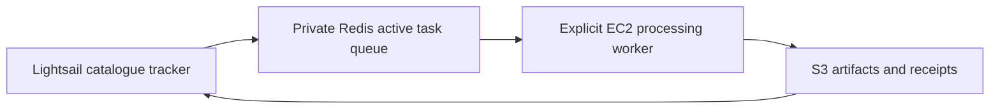

# Catalogue tracker

The dedicated Lightsail host runs `maritime_tip_cue.catalogue`, `maritime_tip_cue.job_manager` and Redis. The
GPU worker host runs `maritime_tip_cue.worker`. Each role has its own dependency list, but both require this
repository's shared `maritime_tip_cue` package source; they are not standalone sparse checkouts yet. The
scheduled catalogue and manager services do not start or stop EC2; the manual one-scene runner below starts it.



## Lightsail installation

The tracker scan and always-on manager run from the same role-specific container image under systemd; Redis
remains the existing Ubuntu systemd service. Build from the repository root with
`sudo docker build -f deploy/catalogue/Dockerfile -t maritime-sts-manager .`. The image contains the deployment
`config.yaml`; both units mount only the persistent host `data/` directory and use `STS_CONFIG_PATH=/app/config.yaml`.
Copy this checkout to `/home/ubuntu/maritime-sts-monitor` and create the ignored `.env` there. It holds the AWS
credentials used for S3, `S3_BUCKET_NAME` and `STS_REDIS_URL`; keep it outside Git. Rebuild the image when code,
rules or deployment config changes. Follow the [Redis host deployment](redis/README.md) before enabling queue writes.

The bundled config keeps the catalogue database and scan log under `/app/data`, which maps to the host's
persistent `data/` directory. Queue lease, heartbeat and retry settings are in that same config.

Establish the baseline by running `sudo docker run --rm --network host --user 1000:1000 --env-file .env -e STS_CONFIG_PATH=/app/config.yaml -v "$PWD/data:/app/data" maritime-sts-manager -m maritime_tip_cue.catalogue scan`.
Verify every site/sensor succeeded, then enable the systemd timer and manager service. Existing scenes are not
queued; `--backfill` is available only as an explicit alternative for an uninitialized channel. Do not delete
the tracker database: it holds the baseline, discovery history and completed job history.

Install `sts-catalogue.service`, `sts-catalogue.timer` and `sts-job-manager.service` from this directory into
`/etc/systemd/system/`, run `systemctl daemon-reload`, then enable both the timer and manager service. The units
invoke Docker as root because the `ubuntu` account has no Docker socket access; each application container runs
as UID 1000 to preserve ownership of the persistent database. They use host networking to reach the Redis service
on localhost. The timer checks four times daily in UTC. The manager service runs in the foreground and restarts
on failure or host reboot. The manager does not start or stop EC2.

## One-scene end-to-end run

This command scans configured hot spots for new Sentinel-2 scenes, stops after the first eligible scene,
stores one single-scene job in SQLite, dispatches that job to Redis, starts EC2 if needed, and runs that exact
job over SSH. The SSH process stays open for the full worker run, keeping the instance active during processing.
If no new scene is found, it leaves EC2 untouched. It does not call a wake-controller URL.

Set these deployment values in the Ubuntu host's ignored `.env`:

```text
WORKER_PRIVATE_IP=<WORKER_PRIVATE_IP>
WORKER_KEY_PATH=/home/ubuntu/.ssh/geogen-key.pem
WORKER_REMOTE_DIR=/home/ubuntu/maritime-sts-monitor
WORKER_IMAGE=maritime-sts-gpu-worker:test
```

The environment must also provide `AWS_REGION`, credentials with EC2 describe/start permissions, and the
existing manager settings. The EC2 host must have the worker checkout, image, assets and instance role prepared.
The worker role must include the results-prefix `s3:ListBucket` permission documented in the worker deployment
guide.
After syncing this checkout and rebuilding the manager image, run on Ubuntu:

```bash
cd /home/ubuntu/maritime-sts-monitor
sudo docker build -f deploy/catalogue/Dockerfile -t maritime-sts-manager .
sudo python3 deploy/catalogue/run-one-scene.py
```

The script waits for the manager to record the result and prints the final job status. It leaves instance
shutdown to the existing lifecycle policy.

## Queue operation

The manager records every attempt in SQLite. Workers heartbeat every configured interval while holding a
lease; expired leases generate manager events. Result writes are fenced by the current owner and attempt ID,
and each attempt writes under its own S3 artifact prefix. A failed or timed-out attempt receives one delayed
retry. A second unsuccessful attempt becomes terminal in SQLite and Redis. Queue recovery rebuilds pending,
retry-waiting and terminal Redis state from the SQLite ledger without re-enqueueing jobs already running.

To scan and hand off only the first new single-scene job to Redis without starting EC2, run on Ubuntu:

```bash
cd /home/ubuntu/maritime-sts-monitor
sudo docker run --rm --network host --user 1000:1000 --env-file .env \
  -e STS_CONFIG_PATH=/app/config.yaml -v "$PWD/data:/app/data" \
  maritime-sts-manager -m maritime_tip_cue.job_manager scan-one
```

The result includes the selected `job_id`. The scan rotates its starting hot spot between runs, stops after
finding one eligible new scene, and creates no job when no new scene is found. First-time channel scans
establish the baseline and do not queue historical scenes.

To list or dispatch one already discovered single-scene job instead, use `catalogue jobs --single-scene` and:

```bash
sudo docker run --rm --network host --user 1000:1000 --env-file .env \
  -e STS_CONFIG_PATH=/app/config.yaml -v "$PWD/data:/app/data" \
  maritime-sts-manager -m maritime_tip_cue.job_manager once --job-id <job_id>
```

The targeted dispatch rejects manifests containing more than one scene. On EC2, use the documented worker
`run --job-id <job_id>` command to claim that exact job; the worker does not drain the rest of Redis. The
regular manager service continues its normal queue reconciliation.

The GPU worker's container build and run guide is in [the worker deployment guide](../gpu-worker/README.md).
Redis must be reachable on the Ubuntu private address from the GPU host; allow TCP 6379 only from the worker
private address or narrowest shared private subnet.

The worker uploads all-hull detection and raw-detection Parquets, run state, manifest and rules under
`catalogue/artifacts/<job_id>/<attempt>/`. For Redis-queued work, its result receipt is stored at the Redis
result key and announced on the result stream; the job manager verifies successful artifact metadata and
records success or failure in SQLite. Direct manifest runs retain the S3 result receipt path at
`catalogue/results/<job_id>.json`. Existing reviewed `sts/`
products are not overwritten.

See [component rationale](../../maritime_tip_cue/context/catalogue.md) for discovery, task grouping, retries
and publication boundaries.
