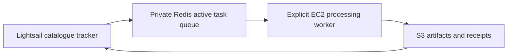

# Catalogue tracker

The dedicated Lightsail host runs `maritime_tip_cue.catalogue` and Redis. EC2 runs
`maritime_tip_cue.worker` when explicitly invoked. This deployment does not start or stop EC2.

## Lightsail installation

Deploy this repository to `/home/ubuntu/maritime-sts-monitor`, create its `.venv` with Python 3.12 and install
`deploy/catalogue/requirements.txt`. Store AWS credentials, `S3_BUCKET_NAME` and `STS_REDIS_URL` in a protected,
ignored `.env`. Follow the [Redis host deployment](redis/README.md) before enabling queue writes.

Run `python -m maritime_tip_cue.catalogue scan` once to establish the baseline. Verify every site/sensor
succeeded before enabling the timer. Existing scenes are not queued; `--backfill` is available only as an
explicit alternative for an uninitialized channel. Do not delete the tracker database: it holds the baseline,
discovery history, and completed job history.

Install `sts-catalogue.service` and `sts-catalogue.timer` from this directory into `/etc/systemd/system/`, run
`systemctl daemon-reload`, then `systemctl enable --now sts-catalogue.timer`. The timer checks four times daily
in UTC. `Persistent=true` catches a missed scheduled activation after downtime.

Install `sts-job-manager.service` into `/etc/systemd/system/`, then run `systemctl daemon-reload` and
`systemctl enable --now sts-job-manager.service`. This continuously reconciles the SQLite job ledger with
Redis, dispatches pending jobs, and handles worker result events. It also sweeps stored Redis receipts every
10 seconds so results are recovered after a service or Redis disconnect. It does not start or stop EC2.

## Queue operation

`python -m maritime_tip_cue.worker list` inspects Redis tasks. `python -m maritime_tip_cue.worker drain`
atomically claims tasks sequentially and exits after the queue is empty. A single task can be run with
`python -m maritime_tip_cue.worker run --job-id <job_id>`. Failed work returns to pending. A task whose process
dies stays in-flight; after verifying no worker is still processing it, run
`python -m maritime_tip_cue.catalogue redis-requeue-stale` to recover it.

The EC2 installation needs this repo's normal processing dependencies, Ai2 detector installation, models,
coastline/structure assets, S3 credentials, AIS credentials and pinned certificate. Set deployment paths in an
ignored `config.local.yaml` selected by `STS_CONFIG_PATH`; set the same protected `STS_REDIS_URL` used by the
tracker. Redis must be reachable on the Ubuntu private address from EC2; allow TCP 6379 only from the EC2
private address or narrowest shared private subnet.

The worker uploads all-hull detection and raw-detection Parquets, run state, manifest and rules under
`catalogue/artifacts/<job_id>/<attempt>/`. For Redis-queued work, its result receipt is stored at the Redis
result key and announced on the result stream; the job manager verifies successful artifact metadata and
records success or failure in SQLite. Direct manifest runs retain the S3 result receipt path at
`catalogue/results/<job_id>.json`. Existing reviewed `sts/`
products are not overwritten.

See [component rationale](../../maritime_tip_cue/context/catalogue.md) for discovery, task grouping, retries
and publication boundaries.
